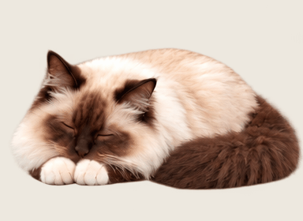
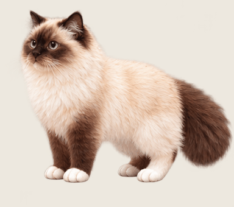

# nomi_desktop_pet · 糯米桌面宠物

一只陪在 macOS 桌面上的布偶猫。Swift + AppKit 提供透明置顶窗口，WKWebView 播放精灵动画，无需联网运行。

## 下载与使用

[下载最新版本](https://github.com/Jameshuang00001/nomi_desktop_pet/releases/latest)

选择 `nomi-desktop-pet-v2.5.0-macos-arm64.zip`，解压，将 **糯米桌面宠物.app** 拖到「应用程序」，双击启动。菜单栏会出现爪印；右键小猫打开设置，拖动小猫调整位置。

- **系统要求：macOS 13 或以上，Apple Silicon（M1/M2/M3/M4 等）。此安装包不支持 Intel Mac。**
- 此个人项目使用 ad-hoc 本地签名，**未经过 Apple 公证**。下载后可能被 Gatekeeper 拦截；确认来源可信后，可按 macOS「系统设置 → 隐私与安全」中的提示允许打开。不需要关闭系统安全保护。
- 退出：右键小猫或点击菜单栏爪印，选择「退出糯米」。

## 功能

- 透明、置顶桌面小窗口，支持拖动和五档大小。
- 自动散步、挥爪、偶尔持续注视鼠标 3–5 秒。
- 解锁或系统唤醒后小睡 45 秒；本地时间 23:00–06:00 持续睡觉。
- 右键手动唤醒；夜间醒来 20 秒后继续睡。
- 可选「允许糯米拉屎」：开启后 30–60 秒开始尝试，之后间隔 5–10 分钟，避开睡眠和其他动作。
- 卡通便便使用独立桌面窗口；支持拖动、右键清理及小猫菜单中的「一键清理」。数量和位置保存到本机偏好设置，重启应用后恢复。
- 小猫与便便窗口配置为不进入 macOS 原生全屏空间。

关闭拉屎开关不会删除已有便便。退出程序后便便窗口关闭，但保存的数据保留；下次启动恢复。

### 动画预览

| 睡觉 | 拉屎动作草稿 |
| --- | --- |
|  |  |

程序中的拉屎动作使用前四帧往返播放，便便是独立窗口；预览 GIF 展示的是素材草稿。

## 从源码构建

需要 macOS、Xcode Command Line Tools（Swift 编译器）、Python 3。测试还需要 Node.js；不依赖第三方 npm 或 Python 包。

```sh
xcode-select --install  # 尚未安装时执行
zsh naigai-desktop/build.sh
```

生成：`dist/糯米桌面宠物.app`。构建脚本目前只生成 arm64，最低系统版本 macOS 13。

运行测试：

```sh
zsh test.sh
```

制作下载包（在构建后执行）：

```sh
COPYFILE_DISABLE=1 ditto -c -k --sequesterRsrc --keepParent \
  'dist/糯米桌面宠物.app' 'dist/nomi-desktop-pet-v2.5.0-macos-arm64.zip'
shasum -a 256 dist/nomi-desktop-pet-v2.5.0-macos-arm64.zip
```

## 项目结构

- `naigai-desktop/main.swift`：窗口、菜单、系统通知和行为调度。
- `SleepPolicy.swift`：夜间作息、解锁小睡、临时唤醒策略。
- `Droppings.swift`：便便窗口、拖动清理、位置保存。
- `gaze.js` / `roam.js` / `sleep.js` / `potty.js`：动画和行为逻辑。
- `assets/original-pet.html`：保留的原始猫咪精灵图和 HTML 模板。
- `naigai-desktop/assets/`：图标及已确认的睡觉、拉屎素材。
- `package.py` / `build.sh`：将模板、脚本和资源打包为 macOS 应用。

猫咪素材和应用图标由 AI 辅助生成。仓库未附带开源许可证，不默认授予额外的再分发许可。

## 当前限制与验证范围

- 保留原版外观和移动精灵素材；自动移动仍使用原版奔跑姿态，并非新制作的自然四足行走。
- 精灵动画的源帧数有限，不宣称为 60 个独立姿态/秒。
- 编译、签名检查及行为/数据单元测试已通过；睡觉、唤醒和独立便便窗口已做实际显示检查。
- 便便拖动/右键清理的完整实机验收，以及所有全屏、多显示器场景仍待补充验证。
- 未做 Apple 公证；不支持 Windows、Linux 或本次发布包之外的 CPU 架构。

偏好与便便位置保存在本机 `local.james.nuomi.htmlpet` 偏好域。应用不会上传这些数据。`dist/motion-check.json` 是本地位移诊断统计，不应提交到仓库。
